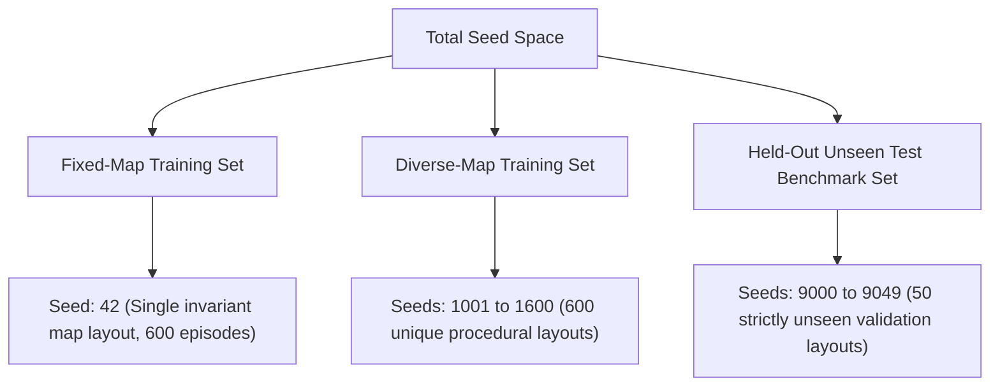

# GRAIL-NAV: Dataset & Environmental Data Generation Specification

## 1. Paradigm: Procedural Generation vs. Static Datasets

In contrast to classical Supervised Learning—which relies on static, pre-labeled offline datasets (such as ImageNet or tabular CSVs)—**Deep Reinforcement Learning (DRL) operates on dynamic interaction data**. In GRAIL-NAV:

- The environment topologies are **procedurally synthesized** on demand using deterministic pseudo-random seeds.
- The training samples are **transition tuples $(s_t, a_t, r_t, s_{t+1}, d_t)$** generated in real-time through the agent's interaction with the simulator and buffered in an Experience Replay Memory.
- The evaluation benchmark consists of a **strictly isolated, held-out test split of 50 procedural obstacle topologies** to assess zero-shot generalization.

---

## 2. Environment & Layout Generation Parameters

| Parameter | Specification | Purpose |
| :--- | :--- | :--- |
| **Grid Dimensions** | $10 \times 10$ ($100$ discrete cells) | Bounded, computationally tractable discrete navigation arena. |
| **Start Coordinate** | Fixed at $(0, 0)$ (Top-Left) | Standardized origin for autonomous mobile robot deployment. |
| **Target Destination** | Fixed at $(9, 9)$ (Bottom-Right) | Consistent terminal goal location across all evaluations. |
| **Obstacle Density** | $18\%$ ($18$ obstacle cells per map) | Creates non-trivial clutter, narrow corridors, and potential dead ends. |
| **Solvability Guarantee** | Breadth-First Search (BFS) Rejection Sampling | Ensures every synthesized map contains at least one obstacle-free path from start to goal. Maps without viable paths are discarded. |
| **Perception Window** | Radius $r=2$ ($5 \times 5 = 25$ cells) | Local sensory field providing real-time barrier awareness. |

---

## 3. Dataset Splits & Seed Partitioning (Preventing Data Leakage)

To test the research hypothesis rigorously and prevent test-set contamination (data leakage), random seed ranges are strictly partitioned into non-overlapping distributions:



### Mathematical Leakage Proof

$$\mathcal{S}_{\text{train, fixed}} \cap \mathcal{S}_{\text{test}} = \{42\} \cap \{9000, \dots, 9049\} = \emptyset$$

$$\mathcal{S}_{\text{train, diverse}} \cap \mathcal{S}_{\text{test}} = \{1001, \dots, 1600\} \cap \{9000, \dots, 9049\} = \emptyset$$

This separation is verified automatically by the test suite in `tests/test_agent.py::test_no_test_seed_leakage`.

---

## 4. Feature Engineering: The 33-Dimensional State Vector

Every sample observed by the policy at time step $t$ is represented by a normalized 33-dimensional numerical continuous vector:

```text
Index [0..1]   : Normalized Agent Position     [r / 9, c / 9] ∈ [0, 1]
Index [2..3]   : Normalized Target Position    [gr / 9, gc / 9] ∈ [0, 1]
Index [4..5]   : Relative Displacement Vector  [(gr - r) / 9, (gc - c) / 9] ∈ [-1, 1]
Index [6]      : Normalized Manhattan Distance (|gr - r| + |gc - c|) / 18 ∈ [0, 1]
Index [7]      : Normalized Euclidean Distance sqrt((gr-r)^2 + (gc-c)^2) / (9 * sqrt(2)) ∈ [0, 1]
Index [8..32]  : Flattened 5x5 Local Occupancy Field around the agent
```

### Local Occupancy Encoding

- **$+1.0$ (Obstacle / Boundary Wall):** Outer grid boundaries and static obstacle blocks.
- **$-1.0$ (Goal Cell):** Target destination detected within sensory radius.
- **$0.0$ (Navigable Space):** Open cells traversable without collision.

---

## 5. Experience Replay Memory (The Training Transition Dataset)

During training, transitions are collected into an Experience Replay Buffer:

- **Buffer Capacity:** $20,000$ transitions.
- **Sample Tuple Structure:**
  $$\tau = \left( s \in \mathbb{R}^{33},\; a \in \{0, 1, 2, 3\},\; r \in \mathbb{R},\; s' \in \mathbb{R}^{33},\; d \in \{0, 1\} \right)$$
- **Batch Sampling:** Uniform random sampling of minibatches ($B = 64$) decorrelates temporally adjacent experiences, satisfying the i.i.d. assumption required for stable gradient descent.

---

## 6. Persisted Output Datasets (CSV Artifacts)

The repository records complete interaction logs in `results/`:

1. **`results/training_fixed.csv`**: 600 rows (one per episode). Fields:
   - `episode`, `scenario`, `reward`, `steps`, `success`, `collision`, `loss`, `epsilon`, `rolling_reward_50`, `rolling_success_rate_50`, `elapsed_seconds`.
2. **`results/training_diverse.csv`**: 600 rows corresponding to the diverse-map training progression.
3. **`results/evaluation_summary.csv`**: Aggregated performance metrics across the 4 conditions of the $2 \times 2$ experimental matrix (50 episodes per condition).
